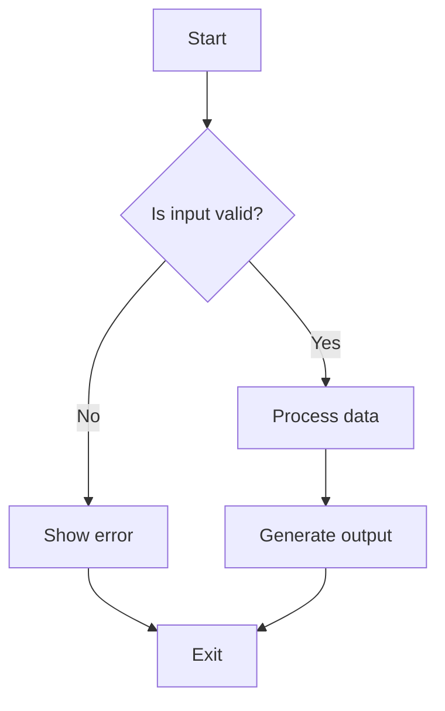
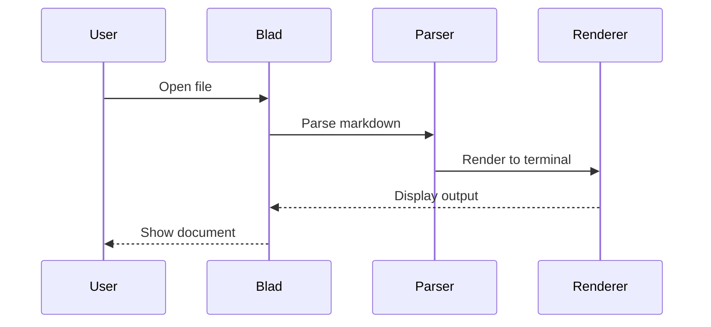
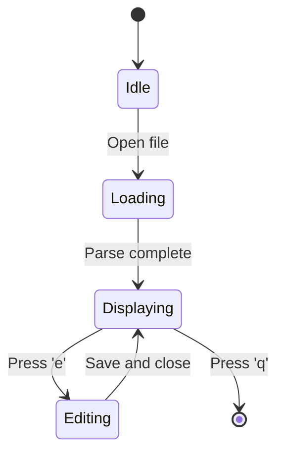
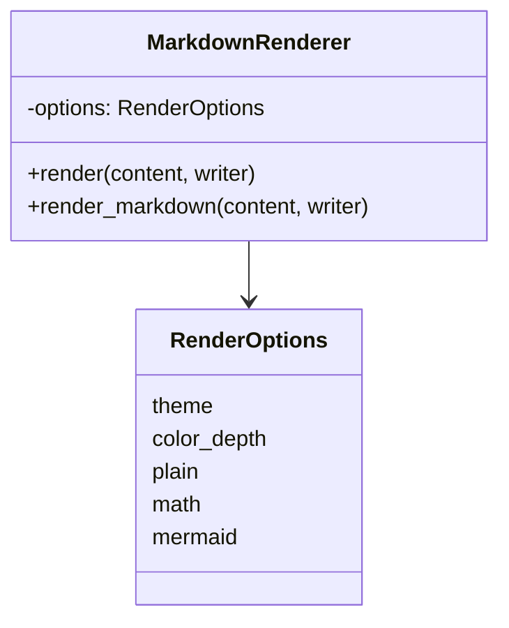
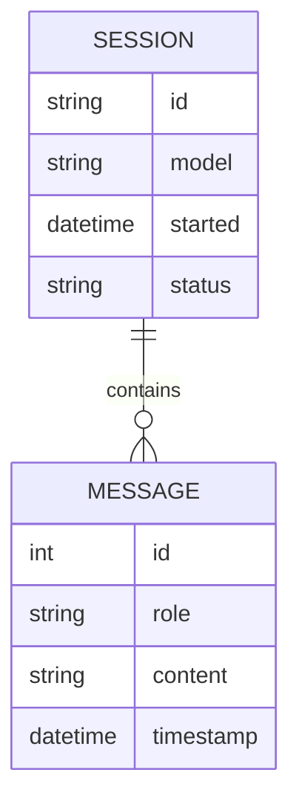

# Blad Feature Showcase

This document demonstrates all Markdown features supported by Blad. Open it
with `blad view docs/EXAMPLES.md` to see rendered output.

## Headers

# Heading 1
## Heading 2
### Heading 3
#### Heading 4
##### Heading 5
###### Heading 6

## Text Formatting

This is **bold** and this is *italic*. You can combine them: ***bold italic***.

This is ~~strikethrough~~ text.

You can also use `inline code` for commands, variables, and identifiers.

## Links and Images

[GitHub](https://github.com) is a web link.

This is an autolink: https://example.com


## Code Blocks

```bash
# Shell script example
for file in *.md; do
    echo "Processing $file"
    blad view "$file"
done
```

```python
# Python example
def fibonacci(n):
    """Generate Fibonacci sequence up to n terms."""
    a, b = 0, 1
    sequence = []
    for _ in range(n):
        sequence.append(a)
        a, b = b, a + b
    return sequence

print(fibonacci(10))
```

```rust
// Rust example
fn main() {
    let numbers = vec![1, 2, 3, 4, 5];
    let doubled: Vec<i32> = numbers.iter().map(|x| x * 2).collect();
    println!("{:?}", doubled);
}
```

## Tables

| Feature | Supported | Notes |
|---------|-----------|-------|
| Headers | ✅ | H1-H6 with color coding |
| Bold/Italic | ✅ | Combined formatting |
| Code blocks | ✅ | 50+ languages via syntect |
| Tables | ✅ | Column alignment |
| Math | ✅ | Inline and display |
| Mermaid | ✅ | Text-only rendering |

### Complex Table

| ID | Status | Description | Priority |
|----|--------|-------------|----------|
| BUG-123 | Open | Fix memory leak in parser | High |
| FEAT-456 | In Progress | Add keyboard shortcuts | Medium |
| DOC-789 | Done | Update user guide | Low |

## Blockquotes

> This is a simple blockquote.
> It can span multiple lines.

### GFM Alerts

> [!NOTE]
> This is a note with important information.

> [!TIP]
> Here's a helpful tip for users.

> [!IMPORTANT]
> This information is crucial to know.

> [!WARNING]
> Be careful with this setting.

> [!CAUTION]
> This action cannot be undone.

## Task Lists

- [x] Complete initial setup
- [x] Write documentation
- [ ] Add more examples
- [ ] Test on different terminals

## Footnotes

This sentence has a footnote[^1] and another one[^2].

[^1]: This is the first footnote.
[^2]: This is the second footnote.

## Superscript and Subscript

Chemical formula: H~2~O

Mathematical notation: x^2^ + y^2^ = z^2^

Combined: E=mc^2^

## Math Expressions

### Inline Math

The famous equation $E=mc^2$ relates energy and mass.

The quadratic formula is $x = \frac{-b \pm \sqrt{b^2-4ac}}{2a}$.

### Display Math

$$\int_0^\infty e^{-x^2} dx = \frac{\sqrt{\pi}}{2}$$

$$\sum_{n=1}^\infty \frac{1}{n^2} = \frac{\pi^2}{6}$$

### Greek Letters

$\alpha$ $\beta$ $\gamma$ $\delta$ $\epsilon$ $\zeta$ $\eta$ $\theta$

$\pi$ $\rho$ $\sigma$ $\tau$ $\phi$ $\chi$ $\psi$ $\omega$

### Operators

$\le$ $\ge$ $\ne$ $\approx$ $\equiv$ $\infty$ $\in$ $\notin$ $\subset$ $\supset$

## Mermaid Diagrams

### Flowchart



### Sequence Diagram



### State Diagram



### Class Diagram



### ER Diagram



## Horizontal Rules

---

A horizontal rule separates sections.

***

A stronger rule, rendered as a heavy line. `~~~` is a code fence, not a rule.

## Lists

### Unordered

- First item
- Second item
  - Nested item
  - Another nested
- Third item

### Ordered

1. First step
2. Second step
   1. Sub-step A
   2. Sub-step B
3. Third step

## Escaping Special Characters

\*Not italic\* but **this is bold**.

\$5.00 is not math, but $5$ is.

Use backslashes to escape: \# not a heading

## Long Lines and Wrapping

Lorem ipsum dolor sit amet, consectetur adipiscing elit. Sed do eiusmod tempor incididunt ut labore et dolore magna aliqua. Ut enim ad minim veniam, quis nostrud exercitation ullamco laboris nisi ut aliquip ex ea commodo consequat. Duis aute irure dolor in reprehenderit in voluptate velit esse cillum dolore eu fugiat nulla pariatur.

## Mixed Content

Here's a paragraph with **bold**, *italic*, and `code` all together. You can also include a [link](https://example.com) and inline math like $x^2$ in the same line.

> A blockquote can contain **formatted text**, [links](https://example.com), and even `code`.

## Empty Lines and Spacing

This paragraph ends here.

And this is a new paragraph after a blank line.

---

*End of Blad feature showcase.*
