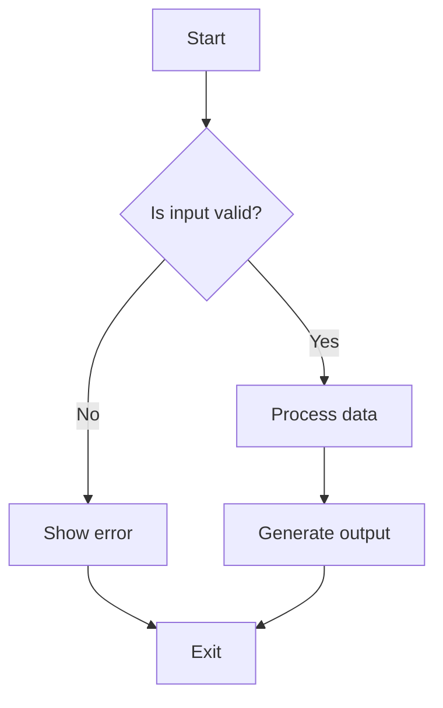
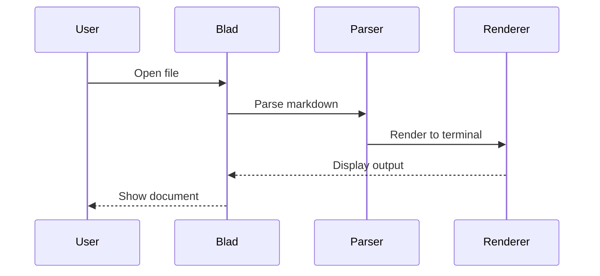
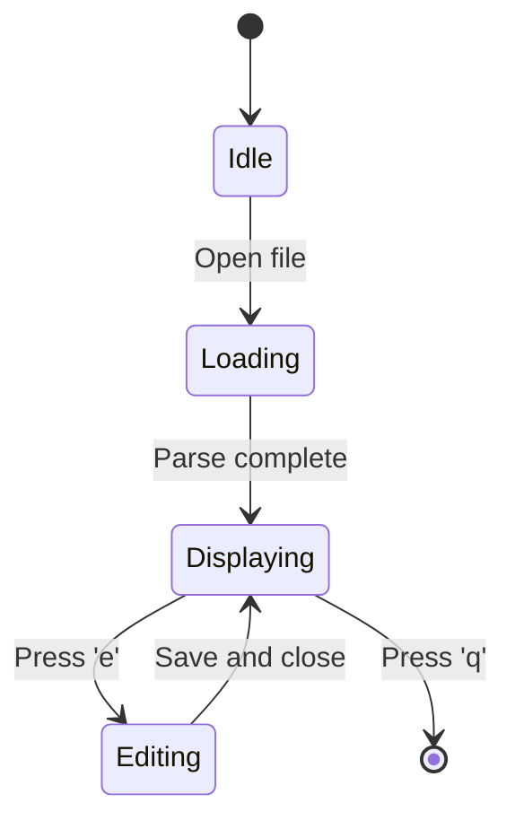
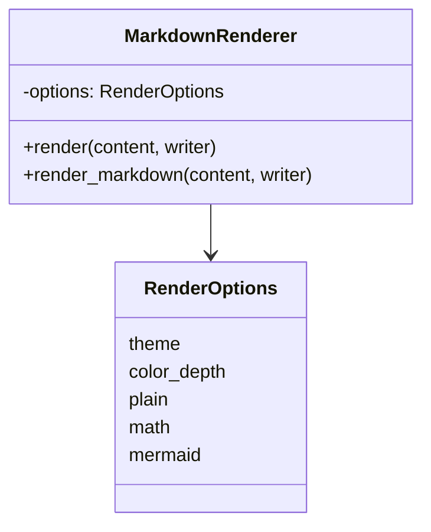
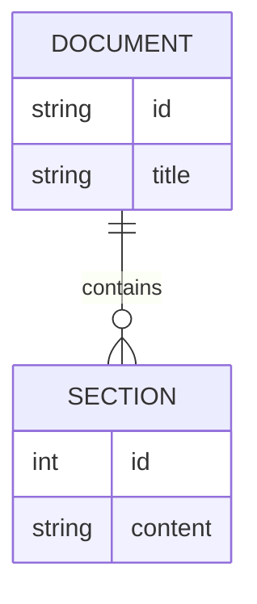

# Blad Feature Showcase

This document exercises Blad's terminal rendering profile. From the repository
root, open it with `blad blad/docs/EXAMPLES.md`, or use `blad docs/EXAMPLES.md`
inside `blad/`. See the [user's guide](USAGE.md) for exact profiles and limits.
This is not a CommonMark/GFM conformance suite: raw HTML is omitted, images
show alternative text only, and individual inline cell emphasis/code styling
is flattened. Tables honor left/center/right delimiter alignment.

## Headers

# Heading 1
## Heading 2
### Heading 3
#### Heading 4
##### Heading 5
###### Heading 6

## Text Formatting

This is **bold** and this is *italic*. You can combine them: ***bold italic***.

This is ~~strikethrough~~ text.

You can also use `inline code` for commands, variables, and identifiers.

## Links and Images

[GitHub](https://github.com) is a web link.

This is an autolink: https://example.com

The [user's guide][guide] is a reference-style local link.
Jump to [task lists](#task-lists) or follow the [math profile](USAGE.md#limited-mathematical-text).
Following an external URL is an explicit viewer action, not a render-time fetch.

[guide]: USAGE.md


The image contributes its alternative text only; no graphic is downloaded.

## Code Blocks

```bash
# Shell script example
for file in *.md; do
    echo "Processing $file"
    blad "$file"
done
```

```python
# Python example
def fibonacci(n):
    """Generate Fibonacci sequence up to n terms."""
    a, b = 0, 1
    sequence = []
    for _ in range(n):
        sequence.append(a)
        a, b = b, a + b
    return sequence

print(fibonacci(10))
```

```rust
// Rust example
fn main() {
    let numbers = vec![1, 2, 3, 4, 5];
    let doubled: Vec<i32> = numbers.iter().map(|x| x * 2).collect();
    println!("{:?}", doubled);
}
```

## Tables

| Feature | Supported | Notes |
|---------|-----------|-------|
| Headers | ✅ | H1-H6 with color coding |
| Bold/Italic | ✅ | Combined formatting |
| Code blocks | ✅ | 50+ languages via syntect |
| Tables | ✅ | Whole-word wrapping and delimiter alignment |
| Math | ✅ | Bounded inline/display text subset |
| Mermaid | ✅ | Admitted spatial text subset |

Left/center/right delimiter markers below align both headers and body cells:

| Left marker | Center marker | Right marker |
|:------------|:-------------:|-------------:|
| First | Second | Third |

### Complex Table

| ID | Status | Description | Priority |
|----|--------|-------------|----------|
| BUG-123 | Open | Fix memory leak in parser | High |
| FEAT-456 | In Progress | Add keyboard shortcuts | Medium |
| DOC-789 | Done | Update user guide | Low |

## Blockquotes

> This is a simple blockquote.
> It can span multiple lines.

### GFM Alerts

> [!NOTE]
> This is a note with important information.

> [!TIP]
> Here's a helpful tip for users.

> [!IMPORTANT]
> This information is crucial to know.

> [!WARNING]
> Be careful with this setting.

> [!CAUTION]
> This action cannot be undone.

## Task Lists

Checked and unchecked state remains visible as `[x]` and `[ ]`, including
with `--dump` or monochrome output.

- [x] Complete initial setup
- [x] Write documentation
- [ ] Add more examples
- [ ] Test on different terminals

## Footnotes

This sentence has a footnote[^1] and another one[^2].

[^1]: This is the first footnote.
[^2]: This is the second footnote.

## Superscript and Subscript

Chemical formula: H~2~O

Mathematical notation: x^2^ + y^2^ = z^2^

Combined: E=mc^2^

Unsupported script characters fall back as a complete span: x^2q^ → x^(2q).
Code stays literal: `H~2~O`, and `~~strikethrough~~` is not subscript syntax.

## Math Expressions

### Inline Math

The famous equation $E=mc^2$ relates energy and mass.

The quadratic formula is $x = \frac{-b \pm \sqrt{b^2-4ac}}{2a}$.

### Display Math

$$\int_0^\infty e^{-x^2} dx = \frac{\sqrt{\pi}}{2}$$

$$\sum_{n=1}^\infty \frac{1}{n^2} = \frac{\pi^2}{6}$$

### Greek Letters

$\alpha$ $\beta$ $\gamma$ $\delta$ $\epsilon$ $\zeta$ $\eta$ $\theta$

$\pi$ $\rho$ $\sigma$ $\tau$ $\phi$ $\chi$ $\psi$ $\omega$

### Operators

$\le$ $\ge$ $\ne$ $\approx$ $\equiv$ $\infty$ $\in$ $\notin$ $\subset$ $\supset$

### Source fallback

Unsupported commands preserve the whole expression with an explanation:
$\unknown{x}$.

Optional root indices are outside the admitted grammar: $\sqrt[3]{x}$.
Use `--math source` to preserve all original expressions instead of projecting.

## Mermaid Diagrams

These five families use a bounded native text renderer, not a browser or
external Mermaid executable. Some syntax/topologies fall back to visible
source; see the [complete Mermaid profile](USAGE.md#mermaid-diagrams).
Use Left/Right for overflow, `--diagram-charset ascii` for structural ASCII,
or `--mermaid source` to inspect authored source.

### Flowchart



### Sequence Diagram



### State Diagram



### Class Diagram



### ER Diagram



The `||` and `o{` cardinalities remain explicit text, not crow's-foot graphics.

## Horizontal Rules

---

A horizontal rule separates sections.

***

A stronger rule, rendered as a heavy line. `~~~` is a code fence, not a rule.

## Lists

### Unordered

- First item
- Second item
  - Nested item
  - Another nested
- Third item

### Ordered

1. First step
2. Second step
   1. Sub-step A
   2. Sub-step B
3. Third step

## Escaping Special Characters

\*Not italic\* but **this is bold**.

\$5.00 is literal currency; numeric-only inline `$5$` also remains literal.
Explicit display mathematics is different: $$5$$

Use backslashes to escape: \# not a heading

## Long Lines and Wrapping

Lorem ipsum dolor sit amet, consectetur adipiscing elit. Sed do eiusmod tempor incididunt ut labore et dolore magna aliqua. Ut enim ad minim veniam, quis nostrud exercitation ullamco laboris nisi ut aliquip ex ea commodo consequat. Duis aute irure dolor in reprehenderit in voluptate velit esse cillum dolore eu fugiat nulla pariatur.

## Mixed Content

Here's a paragraph with **bold**, *italic*, and `code` all together. You can also include a [link](https://example.com) and inline math like $x^2$ in the same line.

> A blockquote can contain **formatted text**, [links](https://example.com), and even `code`.

## Empty Lines and Spacing

This paragraph ends here.

And this is a new paragraph after a blank line.

---

*End of Blad feature showcase.*
